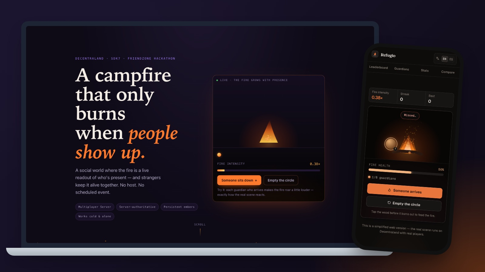
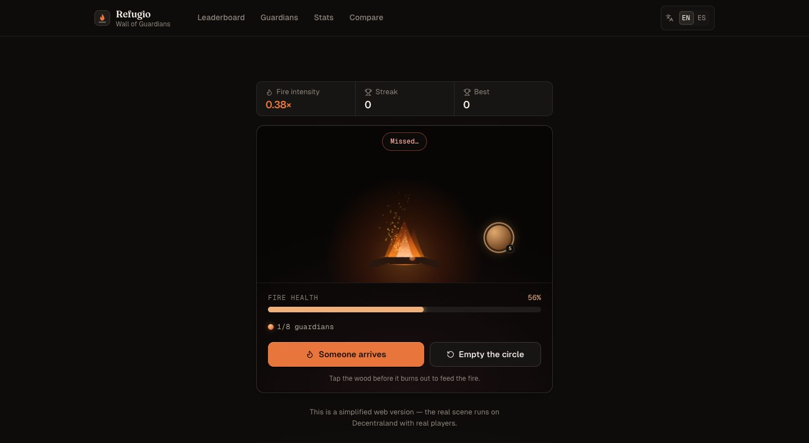
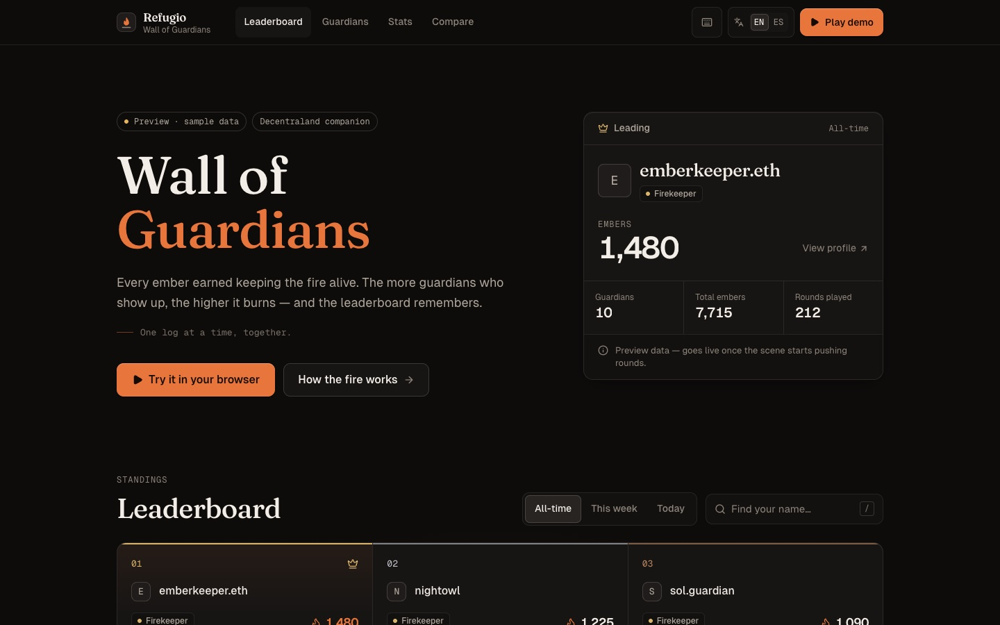
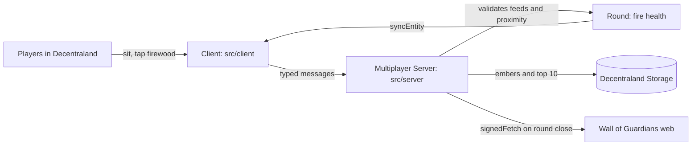

<div align="center">

# Refugio

### A campfire that only burns when people show up.

A cooperative multiplayer scene for **Decentraland (SDK7)**: the fire grows with the players present, and strangers keep it alive together. No host, no scheduled event, no coordination.

[](https://wall-of-guardians.vercel.app/demo)
[](https://wall-of-guardians.vercel.app)
[](docs/submission/buidl-page.md)
[](LICENSE)


<br/>



<sub>The pitch page (<a href="docs/submission/pitch.html"><code>docs/submission/pitch.html</code></a>) and the <a href="https://wall-of-guardians.vercel.app/demo">web demo</a> of the same mechanic. The scene itself runs inside the Decentraland client.</sub>

**[▶ Try it in the browser](https://wall-of-guardians.vercel.app/demo)** · **[Leaderboard](https://wall-of-guardians.vercel.app)** · **[How it works](#-how-it-works)** · **[Run the scene](#-run-it-locally)**

</div>

> [!NOTE]
> **Refugio runs in Decentraland, not on a web page.** To play the real scene you need the [Decentraland desktop client](https://dcl.gg/explorer). The scene is not published to a parcel yet and the demo video is still pending, so for now you can run it locally (below) or try the mechanic in the browser at **[wall-of-guardians.vercel.app/demo](https://wall-of-guardians.vercel.app/demo)**. The web companion lives in **[ALFA117/refugio-wall](https://github.com/ALFA117/refugio-wall)**.

---

## 🎯 The problem

Most social spaces in the metaverse are **empty venues**: alive only during a hosted, scheduled event. Walk in at a random hour and you get a beautiful, lifeless room. That's also this hackathon's hard requirement: an experience that depends on a host or a scheduled event is disqualified.

## 💡 The idea

Refugio is designed so the social moment **emerges from whoever walks in**, at any hour:

- **The fire responds to presence.** One person sees a small flame; a group sees it roar.
- **Sitting is an invitation.** Tap one of the 8 logs to sit; everyone else sees the seat taken.
- **A reason to stay, together.** *Guardians of the Fire* is a 3-minute cooperative round that starts on its own. Firewood appears, anyone taps it in time to feed the flame, and if the fire ends above 50 % health everyone earns **embers** (brasas).
- **Every guardian brings the next one.** An invite link (`?ref=<wallet>`) gives both players a bonus once they finish a round together.

You can enter cold, alone, at 3 a.m., and it still works: the server runs the rounds, the fire still responds, and the moment a second person arrives it becomes social with no one organizing it.

<table>
<tr>
<td width="50%"><p align="center"><sub>The feed-the-fire loop, playable in the browser.</sub></p></td>
<td width="50%"><p align="center"><sub>The public leaderboard outside the metaverse (sample data until the scene pushes rounds).</sub></p></td>
</tr>
</table>

## 🔥 What's inside

| System | What it does | Runs on server |
|---|---|---|
| **Living Fire** | Fire intensity scales with players present | No |
| **Seats** | 8 logs in a circle, tap to sit/stand, occupancy synced | No (`syncEntity`) |
| **Guardians of the Fire** | 3-min cooperative round: firewood spawns, tap-to-feed, fire health | **Yes** |
| **Embers (brasas)** | Currency granted on round end, persisted per wallet | **Yes** |
| **Leaderboard** | Top 10 in world storage, shown in-world | **Yes** |
| **Referral** | `?ref=wallet` link, shared bonus after a round together | **Yes** |
| **Onboarding + HUD** | 3 skippable screens, live ember count, fire-health bar, connecting state | No (UI) |

## 🧠 How it works



Built on **Decentraland SDK7** with the **Multiplayer (authoritative) Server** (`@dcl/sdk@auth-server`) — Decentraland hosts the server automatically on publish, no external infrastructure.

- **`isServer()` split** — one codebase, a `src/client` branch and a `src/server` branch dispatched at runtime ([`src/index.ts`](src/index.ts)).
- **State sync** — `syncEntity` with stable enum IDs for seat occupancy and fire health.
- **Messaging** — a typed message room (`registerMessages` / `room.send` / `room.onMessage`) in [`src/shared/messages.ts`](src/shared/messages.ts).
- **Anti-cheat by design** — the server arbitrates the round it timed, validates every feed (including the player's actual proximity to the firewood, not just a claimed action), and is the sole writer of persistent state. Clients never request rewards.
- **Persistence** — per-wallet ember balances (`Storage.player`) and the world leaderboard (`Storage`) survive sessions and redeploys.
- **UI** — `@dcl/sdk/react-ecs` for onboarding and the in-world HUD.

<details>
<summary><b>Project structure</b></summary>

```
src/
  index.ts              # isServer() dispatcher
  client/               # everything rendered for players
    factory/            # fogata, seats, wood, flame entities + synced components
    systems/            # fogataSystem, seatSystem, minigame (messages + fire visual)
    ui/                 # react-ecs onboarding + HUD
    referral.ts         # reads ?ref= and registers the referral
  server/               # authoritative game loop
    index.ts            # round cycle: spawn wood, decay, validate feeds, end round
    brasas.ts           # ember rewards, referral bonus, Storage, leaderboard
  shared/               # code both branches import
    constants.ts        # tunables (all game numbers live here)
    messages.ts         # typed client↔server message room
    fire.ts             # FireHealth synced component
docs/                   # master prompt, tech spec, submission, planning
```

</details>

## 🛠️ Stack

| Layer | Technology |
|:--|:--|
| Scene | Decentraland SDK7 (`@dcl/sdk@auth-server`) · TypeScript |
| Server | Decentraland Multiplayer (authoritative) Server, hosted by Decentraland on publish |
| State | `syncEntity` for seats and fire health · `Storage` / `Storage.player` for embers and the leaderboard |
| UI | `@dcl/sdk/react-ecs` (onboarding and HUD) |
| Web companion | [refugio-wall](https://github.com/ALFA117/refugio-wall): Next.js 14 · Framer Motion · Vercel KV |

## 🚀 Run it locally

Requires Node ≥ 16 and the [Decentraland Desktop Client](https://dcl.gg/explorer) to render the scene.

```bash
npm install
npm run start
```

This starts the preview server (`http://localhost:8000`) with the Multiplayer Server, and launches the explorer. To test the multiplayer / no-host behaviour, open **two** explorer windows on the same realm and watch seats, the fire, and the mini-game sync between them.

```bash
npm run build    # bundle + type-check (no explorer needed)
npm run deploy   # publish the scene to Decentraland
```

## 📋 Status

The full core experience (all seven systems) is implemented and type-checks clean; it runs against the local Multiplayer Server. **Pending:** multiplayer play-testing with 3+ real players, publishing to a parcel, and the demo video. See [`docs/gestion/`](docs/gestion) for the checklist and planning.

## 📂 Docs

| Document | What it's for |
|:--|:--|
| [docs/submission/buidl-page.md](docs/submission/buidl-page.md) | Hackathon submission (BUIDL page) |
| [docs/submission/pitch.html](docs/submission/pitch.html) | Pitch page |
| [docs/submission/video-guion.md](docs/submission/video-guion.md) | Demo video script |
| [docs/especificaciones-tecnicas.md](docs/especificaciones-tecnicas.md) | Technical spec |
| [docs/gestion/](docs/gestion) | Schedule, submission checklist and multiplayer QA |

## 🏆 Hackathon

Built for the **Friendzone Hackathon** on DoraHacks.

## 📄 License

[MIT](LICENSE)

---

<div align="center">

**Refugio: because a fire is just light until someone sits down next to you.**

</div>
